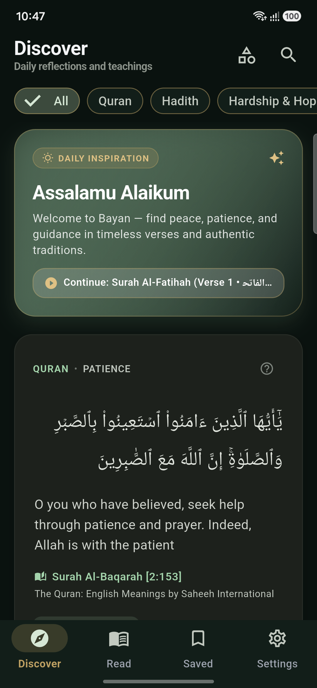
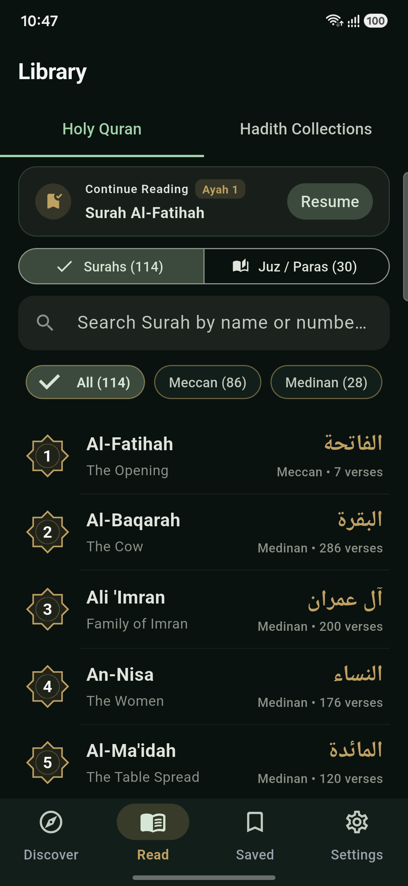
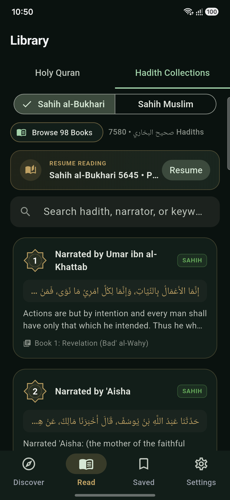
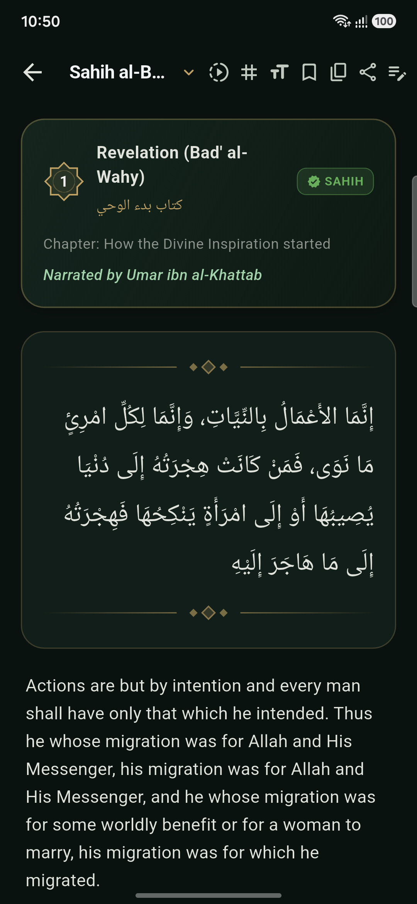
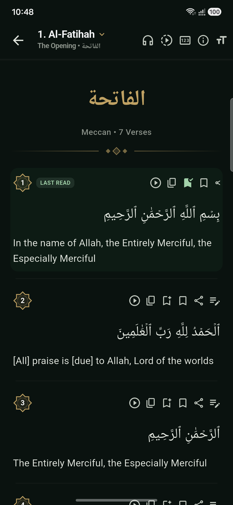
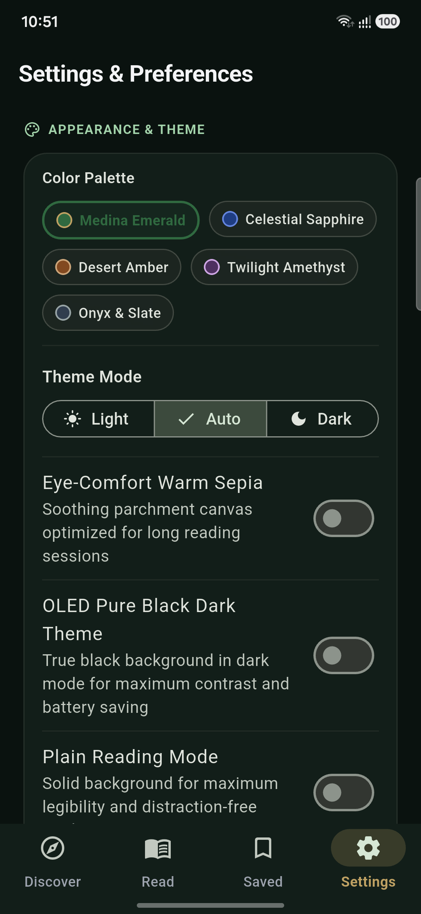

<div align="center">

# Bayan • بَيَان
### Luxury Minimalist Quran & Hadith Companion

An ad-free, privacy-first Islamic contemplation companion crafted with modern minimalism and a pure OLED black aesthetic. Built for deep reflection (*Tadabbur*), synchronized recitation, and daily spiritual grounding.

[](https://flutter.dev)
[](https://android.com)
[](LICENSE)
[](https://github.com/daud0x0/bayan/releases/tag/v1.0.0)
[]()

[**Download APK (v1.0.0)**](release/Bayan-v1.0.0.apk) • [**View Demo Video**](docs/demo/bayan_demo.mp4)

</div>

---

## 📱 Screenshots

<div align="center">
  
  
  
  
</div>

<div align="center">
  
  
  
</div>

---

## 🎥 Walkthrough Video

A quick 20-second walkthrough demonstrating the Discovery feed, Surah reading, and Hadith collections on Android:

> **[Watch Demo Video (`docs/demo/bayan_demo.mp4`)](docs/demo/bayan_demo.mp4)**

---

## ✨ Key Features

### 1. 📖 Thematic Daily Discovery
- Beautifully designed swipeable cards featuring hand-curated Quranic verses and Hadiths.
- Categorized by real-life emotional and spiritual states: **Hardship & Hope**, **Patience (*Sabr*)**, **Gratitude (*Shukr*)**, **Tawakkul**, and more.
- Shareable card generator to create elegant typography cards for social media or friends.

### 2. 🎧 Synchronized Quran Recitation Engine
- Ayah-by-ayah synchronized audio playback highlighting each active verse in real-time.
- Switch between world-renowned Qaris (Mishary Rashid Alafasy, AbdulBaset AbdulSamad, Mahmoud Khalil Al-Husary, Saad Al-Ghamdi, etc.).
- **Hifz Loop Mode:** Repeat individual ayahs or ranges seamlessly for memorization.
- **Hands-Free Auto-Scroll:** Fluid page auto-scrolling with adjustable speed controls.

### 3. 📝 Personal Tadabbur (Reflection) Journal
- Add private reflection notes directly attached to any Ayah or Hadith.
- Track thoughts, lessons, and personal milestones stored safely on your device.

### 4. 📚 Comprehensive Library
- Full **114 Surahs** with Uthmani Arabic script, English translation, transliteration, and revelation context.
- **6 Canonical Hadith Collections** (Sahih al-Bukhari, Sahih Muslim, Sunan Abi Dawud, Jami` at-Tirmidhi, Sunan an-Nasa'i, Sunan Ibn Majah) powered by offline SQLite databases.
- Fast global search across Surah names, Hadith books, and verse contents.

### 5. 🌙 Pure OLED Minimalist Aesthetic
- True Black (`#000000`) background designed for OLED/AMOLED battery efficiency and eye comfort during night readings.
- Elegant Islamic gold accents (`#C5A059`) and refined typographic hierarchy.
- Zero visual clutter, zero banners, zero distractions.

### 6. 🔒 100% Privacy & Offline-First
- No sign-up or accounts required.
- No ads, trackers, or telemetry.
- Quran text, Hadith collections, bookmarks, and reflection notes work completely offline.

---

## 🚀 Getting Started

### Direct Download
Grab the pre-built APK from this repository:
1. Download [`release/Bayan-v1.0.0.apk`](release/Bayan-v1.0.0.apk) (or check the [Releases](https://github.com/daud0x0/bayan/releases) page).
2. Open the APK on your Android device and tap **Install**.

---

### Building from Source

#### Prerequisites
- [Flutter SDK](https://flutter.dev/docs/get-started/install) (v3.24+ recommended)
- [Android SDK](https://developer.android.com/studio) (API 34+)

#### Installation

```bash
# Clone the repository
git clone git@github.com:daud0x0/bayan.git
cd bayan

# Fetch dependencies
flutter pub get

# Run on connected device
flutter run

# Build production APK
flutter build apk --release
```

---

## 🏗️ Architecture

```
lib/
├── app/                  # App initialization, theming (OLED true-black), routes
├── core/                 # Shared utilities, database helpers, audio services
├── features/
│   ├── discover/         # Thematic cards, swipe feed, share cards
│   ├── quran/            # Surah reader, audio player bar, surah sheets, search
│   ├── hadith/           # Hadith collections, chapter navigator, reader
│   ├── read/             # Unified reading hub and library view
│   ├── bookmarks/        # Saved ayahs and hadiths
│   └── settings/         # OLED theme, typography sizes, reciter selection
└── visual_engine/        # Procedural background textures and shaders
```

---

## 📄 License

This project is licensed under the MIT License — see the [LICENSE](LICENSE) file for details.
May this work be a source of continuous benefit (*Sadaqah Jariyah*).
